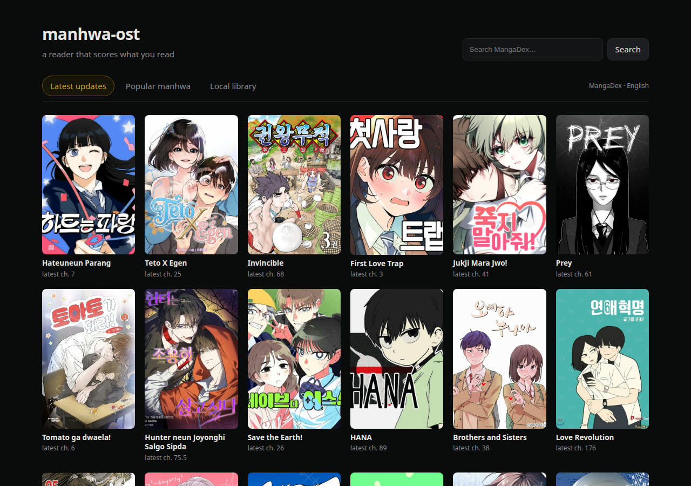
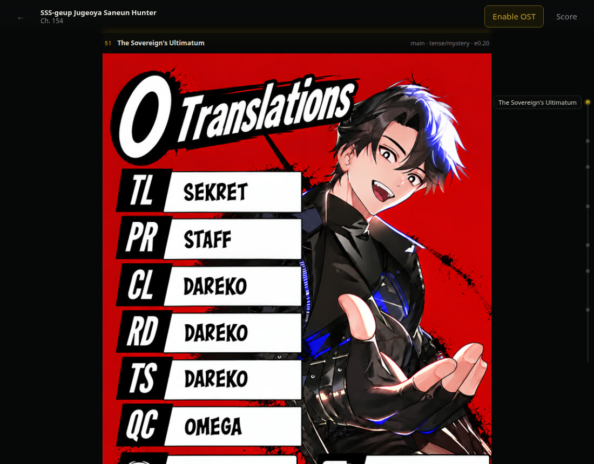

# manhwa-ost

A manhwa reader that composes a soundtrack for the page you are on.

The reader splits a chapter into narrative **sections**, then plays a **cue** for
each section: the same leitmotifs, key and palette across every chapter, a
different arrangement per beat. Music is generated locally with **YuE2** on an
AMD Radeon AI PRO R9700; the pages are read by **DeepSeek V4.1 Flash** over an
opencode-go subscription.





## What makes it work

- **Sections come from the art, not the page count.** A sampled storyboard
  (≤14 pages) goes to a vision-capable model that returns 3–8 contiguous
  sections with mood, energy, tension, a leitmotif id and a music brief.
- **Motifs are real melodies.** The series score book is written in **ABC
  notation**. Every cue is rendered with `cot=melody|full` + `abc_file` + a
  fixed seed, so the melody is identical by construction and only the
  arrangement changes. Measured: three wildly different style prompts, one key
  (D minor), chroma similarity 0.96–0.98; a no-ABC control landed in F minor.
- **Cue changes continue the music.** `semantic_prefix_file` lets a new cue
  start from the exact semantic state the previous one ended in — verified
  frame-for-frame (50/50 identical).
- **Instrumental beds.** YuE2's instrumental AR adapter with `cot=full` and
  empty lyrics.

## Quickstart

Requirements: Linux with ROCm (tested on ROCm 7.1 / gfx1201), Python 3.12 with
`uv`, Node 20+, `ffmpeg`, an `opencode` CLI with a vision-capable model, and
YuE2 GGUF weights at `$YUE2_MODEL_ROOT`.

```bash
# 1. engine source (audio.cpp pinned at 624cf918) + HIP build
tools/fetch-engine.sh
tools/build-engine.sh

# 2. python env + API
uv venv --python 3.12 /srv/manhwa-ost/venv
uv pip install --python /srv/manhwa-ost/venv/bin/python -r services/composer/requirements.txt numpy scipy soundfile librosa jsonschema

# 3. both services
tools/dev-up.sh
```

Open <http://127.0.0.1:5173>, pick a series, open a chapter, press
**Compose OST** (≈90–240 s for a 20-page chapter), then **Enable OST** and read.

`tools/browser-check.py <manga_id> <chapter_id>` drives headless Chrome through
the same flow and reports whether a cue actually loaded and switched on scroll.

## How a chapter becomes music

```
MangaDex → pages → storyboard (≤14 pages @760px)
        → deepseek-v4.1-flash → analysis.json (3–8 sections, schema-validated)
        → YuE2 (abc_file + instrumental LoRA) → one cue per (motif, energy)
        → opus + key/bpm fingerprint + loop window → timeline.json
        → reader: progress → section → crossfaded cue
```

Details, file layout and limits: [`docs/pipeline.md`](docs/pipeline.md).
Spike measurements: [`docs/spikes-2026-10-26.md`](docs/spikes-2026-10-26.md).

## Status

Working vertical slice, not a product.

- ✅ end-to-end: source → reader → composed chapter, verified in a browser
- ✅ consistent key/motif across arrangements
- ✅ cue continuity via semantic prefix
- ⏳ series score book (so chapter 155 reuses chapter 154's arrangements)
- ⏳ beat-aligned loops / tempo lock (BPM detection is currently ambiguous)
- ⏳ more sources — MangaDex coverage for licensed manhwa is thin
- ⏳ Mihon fork on Android (the reader here is a browser stand-in; Mihon has no
  web target, so the timeline/audio module will be ported to Kotlin/Media3)

## Layout

```
apps/web-reader/     React + TypeScript reader, Web Audio cue engine
services/composer/   FastAPI: sources, brain, render queue, asset server
contracts/           JSON Schema + the ABC score book
tools/               engine build, benchmarks, browser check, dev-up
docs/                pipeline, decisions, spike measurements
```

## Licenses and content

Code is MIT (see `LICENSE`). YuE2 weights and the audio.cpp engine are
downloaded separately under their own terms; the instrumental adapter is
CC BY-NC 4.0, so audio made with it is non-commercial. No manga pages, model
weights or generated audio are committed here.
